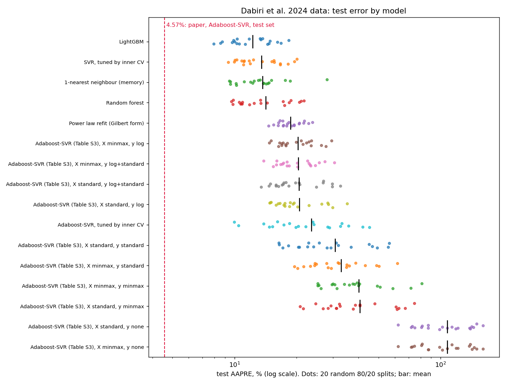
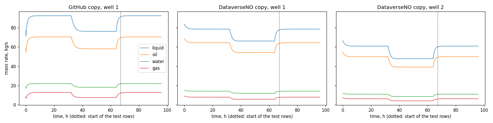

# Reproducing two virtual flow metering benchmarks

**Kaggle notebook (runs end to end):**
[Reproducing Two Virtual Flow Metering Benchmarks](https://www.kaggle.com/code/sankalpsthakur/reproducing-two-virtual-flow-metering-benchmarks)

We wanted public benchmarks for a wellhead-choke flow model, so before treating two published numbers as bars we
tried to reproduce them. Both papers released data or code, which is what made the check possible.

Every number below comes from the notebook in [`notebook/`](notebook/), which downloads its sources at run time. The
outputs of that run are in [`results/`](results/): Kaggle version 1, a private run of the same code as the public
version. Section 2.5 is the one exception: its numbers come from a private run on files the D'Souza et al. authors
shared with us, which we may not redistribute.

## TL;DR
- **Dabiri et al. 2024 (*Sci Rep*), 565 wellhead-choke tests.**
  - The released data match the paper exactly: all 40 entries of Table 3, and four of the five correlation errors in
    Table 7.
  - The headline result does not reproduce. Adaboost-SVR with the published settings averages 20.3% test AAPRE at
    best over 20 random 80/20 splits, against the reported 4.57%.
  - Across 200 splits, the best model we tried (LightGBM) never goes below 7.1%.
  - 124 of the 565 rows sit in 44 groups of exact duplicates, so about 20% of a random test set has a copy in
    training.
- **D'Souza et al. 2024 (SIMS EUROSIM), two simulated gas-lifted wells. Updated November 2026, see
  [section 2.5](#25-the-authors-data-november-2026).**
  - **What we first wrote.**
    - The CSVs behind Table 1 are not released, and neither released copy of the simulator reproduces them.
    - Run as released, both copies return to the first step's exact state in the test window, where the paper's
      figures show a new level. So all ten of the paper's models score below 1% MAPE on regenerated data, while Table
      1 reports 1.5-16.7%.
  - **What the authors have since shown us.** They shared both CSVs privately, with the configuration that made them:
    - the gas-lift share varied from 10% to 100% in each well, giving ten runs per well;
    - a one-minute step;
    - the mean of the ten runs.

    Neither the paper nor the release states this configuration.
  - **Well 1 now reproduces.**
    - With that configuration, the released GitHub simulator reproduces the well-1 file exactly: every value agrees to
      within 7 × 10⁻¹⁰ in relative terms.
    - The test window's new level comes from a single run. At a 20% share the well dies when the supply halves and
      does not restart, which lowers the mean of the ten runs by 8.9%.
  - **Well 2 does not.** No configuration in the release reproduces the well-2 file.
  - **Table 1 partly reproduces on the authors' files.**
    - 13 of the 20 published MAPE values agree within the tolerance we set before the check.
    - The LSTM is the best model on both wells, as published.
    - Three well-1 values fall below 1%.
  - As released, the simulation script asks a helper for 20 outputs when it declares 17, which is an error in MATLAB
    and Octave.
- Our own first pass got the D'Souza part wrong; [section 2.4](#24-a-correction-to-our-own-first-pass) says how.
  [Questions for the authors](#questions-for-the-authors) are at the end.

## 1. Dabiri et al. 2024: 565 wellhead-choke tests
Dabiri, M.-S. et al. (2024). Modeling liquid rate through wellhead chokes using machine learning techniques.
*Scientific Reports* 14, 6945. [doi:10.1038/s41598-024-54010-2](https://doi.org/10.1038/s41598-024-54010-2)
(CC BY 4.0).

- **Inputs:** wellhead pressure (psi), gas-liquid ratio (scf/stb) and choke size (1/64 in).
- **Target:** liquid rate (stb/d).
- **Data:** 565 rows compiled from eight literature sources, in the supplementary DOCX.
- **Headline:** the best of six machine-learning models, Adaboost-SVR, reports a test-set AAPRE of 4.57% on a random
  80/20 split (Table 6). The abstract's 5.15% is the whole-set figure, and the training-set figure is 5.3%.

### 1.1 What reproduces
Our parse of the DOCX matches all 40 entries of Table 3 (descriptive statistics) to the printed precision. For four
classic correlations, Table 7's errors match too:
- AAPRE and APRE (measured minus predicted) match to the printed precision.
- RMSE matches to within 0.04 stb/d.
- The paper's R² is the squared correlation (within 0.004), not 1 - SSE/SST.

| Correlation | AAPRE, paper | AAPRE, ours | RMSE, paper | RMSE, ours |
|---|---|---|---|---|
| Gilbert | 22.36 | 22.36 | 2,418.76 | 2,418.76 |
| Ros | 21.32 | 21.32 | 2,221.49 | 2,221.51 |
| Baxendell | 20.36 | 20.36 | 1,915.18 | 1,915.21 |
| Achong | 21.05 | 21.05 | 1,641.73 | 1,641.73 |
| Pilehvari | 51.82 | 122.09 | 5,107.94 | 11,175.15 |

Our Pilehvari constants (A = 46.67, B = 0.313, C = 2.11) don't give the paper's 51.82%; we leave that open.

### 1.2 What does not reproduce
The paper gives no seed for its random 80/20 split, so we use 20 seeds, with the same splits for every model.
- **Replicate.** It follows the supplementary Table S3: `AdaBoostRegressor` over
  `SVR(C=1.0, epsilon=0.1, kernel='rbf', gamma='scale')`.
- **Scaling.** The paper doesn't say how inputs and target were scaled, and with `epsilon=0.1` that choice matters, so
  we run ten combinations. On a min-max-scaled target, 0.1 is a tenth of the whole rate range.
- **Tuned versions.** The SVR is also tuned by 5-fold cross-validation inside each training set, with and without
  boosting.

| Method | Test AAPRE, mean [95% CI] | Best split | Training AAPRE |
|---|---|---|---|
| LightGBM | 12.23 [10.84, 13.63] | 7.92 | 3.69 |
| SVR, tuned by inner CV | 13.54 [11.96, 15.11] | 9.33 | 9.56 |
| 1-nearest neighbour (pure memory) | 13.69 [11.70, 15.67] | 9.45 | 0.09 |
| Random forest | 14.20 [12.24, 16.16] | 9.65 | 4.50 |
| Power law refit (Gilbert form) | 18.73 [17.54, 19.91] | 14.66 | 17.39 |
| Adaboost-SVR, Table S3, best scaling (min-max inputs, log target) | 20.30 [18.28, 22.32] | 14.73 | 17.47 |
| Adaboost-SVR, tuned by inner CV | 23.64 [18.94, 28.35] | 9.97 | 2.80 |
| Adaboost-SVR, Table S3, min-max inputs and target | 40.08 [32.88, 47.27] | 25.33 | 33.74 |
| Adaboost-SVR, Table S3, unscaled target | 107.7 [93.6, 121.9] | 62.1 | 103.3 |
| *Paper, Adaboost-SVR* | *4.57* | | *5.3* |

All sixteen methods are in [`results/audit_results.json`](results/audit_results.json), and every split is in
[`results/dabiri_runs_random_split.csv`](results/dabiri_runs_random_split.csv).
- **Table S3 settings.** The lowest single split of any Table S3 variant is 13.5%.
- **Tuning.** Tuning helps a single SVR but makes the boosted one unstable, with a few very large misses.
- **Many splits.** Over 200 random splits, LightGBM averages 11.9%; its best split is 7.1% and its 5th percentile
  9.0%.

### 1.3 Duplicate rows
- **Duplicates.** 124 rows (22%) sit in 44 groups of identical rows, the largest with 10 copies.
- **Conflicting rates.** 6 input triples carry two or more different rates.
- **Leakage under a random split.** On a random 80/20 split, 19.7% of test rows have an exact copy in training (9.7-25.7%
  over 20 seeds).
- **Grouped splits.** With duplicate groups kept on one side, LightGBM rises to 13.9% and the nearest-row lookup to
  15.2%. The order of the models doesn't change.
- **Pure memory.** The nearest-row lookup scores 13.7% on random splits, so the duplicates alone don't produce
  numbers near 4.57%.

### 1.4 Two further observations
- **External validation (Table 8).** The paper tests Adaboost-SVR on 28 points from another source, which it
  describes as outside the training and test data. Table 8 lists measured and predicted rates but not the inputs.
  - 8 of the 28 predictions equal the measured value to the printed precision (1900.2 and 1900.2, for example).
  - 4 more equal a different measured value in the same table (1900.5 predicted as 1680.1, for example).
  - The 28 pairs give an AAPRE of 11.3%.
  - Exact agreement is unusual for a regression model on inputs it hasn't seen. Without the inputs we can't re-run
    these points, so this is a question for the authors, not a finding.
- **Model settings.** Table S3 doesn't pin down the models behind Table 6:
  - its RBF row repeats the Adaboost-SVR base learner's settings;
  - its MLP-LM and MLP-BR rows are identical;
  - scikit-learn has no `scg` solver;
  - Table 4's two hidden layers and 250-neuron RBF network don't appear in it.

## 2. D'Souza, Pfeiffer & Mirlekar 2024: two simulated gas-lifted wells
D'Souza, N. A., Pfeiffer, C. & Mirlekar, G. (2024). Assessment of data-driven techniques for flow rate predictions in
sub-sea oil production. *Proceedings of SIMS EUROSIM 2024*. [doi:10.3384/ecp212.014](https://doi.org/10.3384/ecp212.014)

- **Data.** The paper simulates two gas-lifted wells with the open-loop model of Janatian et al. (2022) and reports
  5,762 samples per well. It does not say how they were made.
  - The file names (`Well1_average_data.csv`) suggested averaging.
  - The authors have since told us that each file is the mean of ten runs at gas-lift shares of 10% to 100%
    ([section 2.5](#25-the-authors-data-november-2026)).
- **Split.** Each series is split in time: training, validation, then the last 30% as test.
- **Models.** Ten regressors predict three mass rates from gas-lift rate, bottomhole pressure and wellhead pressure.
- **Headline.** Table 1 reports test MAPE; the best is an LSTM, at 1.96% for well 1 and 1.53% for well 2.

### 2.1 What is released
- **Data.** Neither the [GitHub repository](https://github.com/dsouzaneville/FMH606-1-Masters-Thesis) nor the
  [DataverseNO deposit](https://doi.org/10.18710/KIJEWJ) contains `Well1_average_data.csv` or
  `Well2_average_data.csv`. The authors have since shared both files with us privately. They are not redistributed
  here.
- **Code.**
  - Both notebooks read the well-1 file, which had 5,762 rows according to their saved output.
  - No released code computes the MAPE values in Table 1.
  - As released, the GitHub script asks `calculate_output` for 20 outputs when it declares 17 (`rho_l`, `V_G` and
    `rho_m` are missing).
  - Its CSV-writing lines are commented out, and its CSV header differs from the one the notebooks read.
- **Small differences from the paper:**
  - the notebook's MLP has one hidden layer of two neurons (`hidden_layer_sizes=(2)`), where the paper describes two
    hidden layers;
  - the scaler is fit on all rows, where the paper says the training set;
  - the abstract gives 1.56% for well 2's LSTM, where Table 1 gives 1.53%.

### 2.2 Regenerating the data
We ran both released copies in Octave, each with its own settings:
- **GitHub copy:** single well, `Theta_nom = [2.51 0.05 0.2]`, all of the gas-lift supply to the well.
- **DataverseNO copy:** the original two-well model, 30% of the supply to each well.

Both apply the same supply schedule: 40,000, then 20,000, then 40,000 Sm³/h, in three equal steps over 96 h. The
notebooks test on rows 4,033 onward (from 67.2 h), inside the third step.

| Series | Liquid, step 1 (kg/s) | Liquid, step 2 | Liquid, test window | Test window vs step 1 |
|---|---|---|---|---|
| GitHub copy, well 1 | 92.47 | 76.26 | 92.47 | 0.0% |
| DataverseNO copy, well 1 | 78.58 | 66.21 | 78.58 | 0.0% |
| DataverseNO copy, well 2 | 60.96 | 47.83 | 60.96 | 0.0% |
| Paper, Fig. 6, largest well-1 curve (read off the figure) | about 78 | about 62 | about 71 | about -9% |
| Authors' file, well 1 (shared November 2026) | 78.08 | 63.95 | 71.14 | -8.9% |
| Authors' file, well 2 (shared November 2026) | 75.11 | 49.11 | 69.34 | -7.7% |

The levels are means over 20-30 h, 52-62 h and 85-95 h.

What the comparison shows:
- **Released copies.** Each was run at a single gas-lift share. In both, every rate and pressure returns exactly to
  the first step's state in the test window, and the series are smooth.
- **The paper's figures.**
  - The test window sits at a new level.
  - The model predictions oscillate during the second step, so the inputs did too.
  - The authors' files confirm both points. In step 2 the well-1 pressures reverse direction at 1,883 of 1,920
    minutes.
- **The GitHub copy.**
  - Its oil-to-liquid ratio (0.762, from water cut 0.2) matches the figure's (about 60/78).
  - At a single share its levels don't match. Averaged over the authors' ten shares they match exactly, and it is the
    source of the well-1 file ([section 2.5](#25-the-authors-data-november-2026)).

### 2.3 The paper's models on regenerated data
Settings follow the GitHub notebooks for well 1 and the paper's text for well 2, with the notebooks' split rows. The
table shows test MAPE (%) on the oil, gas and liquid targets, as the notebooks name them. The released script writes
oil, water and gas; that variant is in [`results/dsouza_model_mape.csv`](results/dsouza_model_mape.csv), and
every model stays below 1% there too.

| Model | Paper, well 1 | GitHub copy, well 1 | DataverseNO, well 1 | Paper, well 2 | DataverseNO, well 2 |
|---|---|---|---|---|---|
| LSTM | 1.96 | 0.51 | 0.24 | 1.53 | 0.28 |
| MLP | 2.43 | 0.02 | 0.03 | 5.49 | 0.65 |
| Multivariate linear regression | 2.14 | 0.02 | 0.00 | 7.57 | 0.00 |
| SVR | 5.04 | 0.32 | 0.38 | 4.31 | 0.62 |
| KNN | 8.05 | 0.00 | 0.07 | 5.41 | 0.07 |
| Decision tree | 9.26 | 0.74 | 0.38 | 5.43 | 0.07 |
| Gradient boosting | 4.95 | 0.00 | 0.03 | 5.55 | 0.04 |
| XGBoost | 4.23 | 0.20 | 0.12 | 5.56 | 0.03 |
| PLS | 9.54 | 0.13 | 0.24 | 7.57 | 0.28 |
| PCR | 9.52 | 0.14 | 0.25 | 16.69 | 0.29 |

When the test window repeats the training conditions, the task is interpolation. The published numbers come from data
we could not regenerate from the release alone. On the authors' own files the same models score 0.8% to 13%, in the
paper's range ([section 2.5](#25-the-authors-data-november-2026)).

### 2.4 A correction to our own first pass
Our first, private pass regenerated only the DataverseNO copy. We read its sub-1% scores as a sign that the released
simulator produces trivially clean data, and that the paper's CSVs must carry processing missing from the release.
That was wrong. The scores are low because the test window repeats the first step. The paper's figures show a test
window that doesn't, so its data came from a configuration that isn't in the release. The authors' configuration,
in section 2.5, confirms this.

### 2.5 The authors' data (November 2026)
On Nov 2 2026 the authors answered [question 4](#questions-for-the-authors). They shared `Well1_average_data.csv`
and `Well2_average_data.csv` privately, with the configuration that made them:
- the gas-lift share varied from 10% to 100% in each well, giving ten runs per well;
- a one-minute time step;
- each file is the mean of its well's ten runs.

The paper doesn't state this configuration. Its section 2.3 says only that an open-loop simulation gave 5,762 samples
per well, split 70/30. Neither released copy contains it either.

The files are not ours to redistribute, so these checks ran in a private Kaggle kernel, unlike every other number in
this README. The script is [`check.py`](checks/dsouza_shared_data/check.py). We wrote the criteria before running
anything, in [`PREREGISTRATION.md`](checks/dsouza_shared_data/PREREGISTRATION.md).

**The simulator with the authors' configuration.**

| Released copy, run with the authors' configuration | Well 1 | Well 2 |
|---|---|---|
| GitHub single-well, one-minute step | Reproduces: every value in every column within 7 × 10⁻¹⁰ (relative), first row included | Not possible: the release has no well-2 configuration |
| DataverseNO two-well, one-minute step | Does not: 10% off at the first row | Does not: 10% off at the first row |
| DataverseNO two-well, 20 s step averaged to one minute | Does not: 10% off at the first row | Does not: 10% off at the first row |

- **The two-well copy** was our primary candidate, since it is the one with two wells. It fails at both step sizes.
- **The single-well copy** was the fallback we had pre-registered, and it is the source of the well-1 file.

**Why the test window sits at a new level.** In the ten well-1 runs:
- at a 10% share, the well stops flowing during start-up and never restarts;
- at a 20% share, it flows at 69.4 kg/s in step 1, stops when the supply halves, and doesn't restart when the supply
  returns;
- at 30% to 100%, it returns exactly to its step-1 state, as our single-share runs did.

So the mean of the ten runs loses 6.94 kg/s of liquid between step 1 and the test window. That is the file's drop
from 78.08 to 71.14 kg/s (-8.9%), which we had read off Fig. 6 as about -9%.

**Table 1 on the authors' files.** The models, settings and split rows are those of section 2.3. We pre-registered
three judgements:
- **Every value above 1% MAPE: not met.** Three well-1 values are below 1%: the LSTM (0.83), linear regression (0.96)
  and the MLP (0.96).
- **Agreement with Table 1: partly.** 13 of the 20 values agree within the tolerance we set, which is the larger of
  0.5 points and 25% of the published value.
- **The LSTM ranks first on both wells, as published: met.**

In the table, ✓ marks agreement within that tolerance. Each well has two columns of ours:
- **Notebooks' scaler:** inputs scaled on all rows, as in the authors' notebooks. This is the pre-registered
  protocol.
- **Paper's scaler:** fit on the training rows, as the paper's section 2.4 says.

| Model | Paper, well 1 | Ours, well 1, notebooks' scaler | Ours, well 1, paper's scaler | Paper, well 2 | Ours, well 2, notebooks' scaler | Ours, well 2, paper's scaler |
|---|---|---|---|---|---|---|
| LSTM | 1.96 | 0.83 (0.31-2.05) | 2.15 ✓ | 1.53 | 1.78 (1.34-2.21) ✓ | 12.57 |
| MLP | 2.43 | 0.96 | 0.97 | 5.49 | 3.63 | 5.50 ✓ |
| Multivariate linear regression | 2.14 | 0.96 | 0.96 | 7.57 | 7.49 ✓ | 7.49 ✓ |
| SVR | 5.04 | 2.17 | 3.88 ✓ | 4.31 | 6.75 | 4.71 ✓ |
| KNN | 8.05 | 8.06 ✓ | 8.81 ✓ | 5.41 | 4.98 ✓ | 4.36 ✓ |
| Decision tree | 9.26 | 8.84 ✓ | 8.84 ✓ | 5.43 | 5.29 ✓ | 5.29 ✓ |
| Gradient boosting | 4.95 | 5.54 ✓ | 5.19 ✓ | 5.55 | 5.56 ✓ | 5.56 ✓ |
| XGBoost | 4.23 | 5.14 ✓ | 5.14 ✓ | 5.56 | 5.20 ✓ | 5.20 ✓ |
| PLS | 9.54 | 9.55 ✓ | 9.55 ✓ | 7.57 | 12.99 | 12.99 |
| PCR | 9.52 | 9.92 ✓ | 9.92 ✓ | 16.69 | 13.06 ✓ | 13.06 ✓ |
| **Agreeing cells** | | **6 of 10** | **8 of 10** | | **7 of 10** | **8 of 10** |

The LSTM values under the notebooks' scaler are medians of ten seeds, with their range in brackets. Under the paper's
scaler they are medians of three seeds.

What the table does and doesn't say:
- **The paper's scaler gives 16 of 20.** We pre-registered it as a sensitivity to report, not to judge. We also added
  its count to the check only after an earlier run had shown check A's values, so it carries less weight than the 13.
- **Neither scaler fits all of Table 1.** Under the paper's scaler, well 2's LSTM scores 12.57 against the published
  1.53. No single protocol we tried reproduces the whole table.
- **Three cells disagree under both scalers.**
  - Well 1's linear regression and its identity-activation MLP, a linear model too, both score 0.96 against the
    published 2.14 and 2.43.
  - Well 2's PLS scores 12.99 against the published 7.57. Table 1 also gives 7.57 for linear regression on well 2,
    which scores 7.49 on the file.
- **Some cells agree almost exactly.** Examples are KNN on well 1 (8.06 against 8.05) and the MLP on well 2 under the
  paper's scaler (5.50 against 5.49). We read these as consistent with the files being Table 1's data, not as evidence
  of which protocol the authors used.
- **Gradient boosting moves between runs.** It is unseeded in the notebooks, as here. On well 1 our two runs gave 5.25
  and 5.54, both within the tolerance.

**What this changes.**
- **The regime.** The data behind Table 1 is not the interpolation regime of our single-share runs. On it the models
  score from 0.8% to 13%, in the paper's range.
- **Public reproducibility.**
  - Well 1's file can now be regenerated from the public GitHub release with the configuration above. So its numbers
    could move into the public notebook.
  - Well 2's can't, until its parameters are known.
- **Still open.** We have asked the authors for the well-2 parameters, and whether the files may be released.

## Summary
| | Reproduces | Does not reproduce |
|---|---|---|
| Dabiri et al. 2024 | The data (Table 3, exactly); Table 7's AAPRE, RMSE and APRE for 4 of the 5 classic correlations | Adaboost-SVR's 4.57% test AAPRE: 20.3% at best with the stated settings, and 7.1% on the best of 200 splits for the best model we tried; Pilehvari's 51.82% |
| D'Souza et al. 2024 | The simulator runs, once its outputs are taken from `oil_field_model`. With the configuration the authors shared in November 2026, the GitHub copy reproduces the well-1 data exactly. On the authors' files, 13 of Table 1's 20 values agree within our tolerance, and the LSTM ranks first on both wells | The data, from the release alone: run at one gas-lift share, both copies return to the first step in the test window. The well-2 data, whose configuration is not in the release. 7 of Table 1's 20 values, including well 1's two linear models (0.96% against 2.14% and 2.43%) |

## Questions for the authors
1. **Dabiri et al.:** which split (seed or row indices) and which input and target scaling produced Table 6?
2. **Dabiri et al.:** how were the Table 8 predictions produced? 8 of 28 equal the measured value exactly, and 4 equal
   another measured value in the table.
3. **Dabiri et al.:** which Pilehvari constants give 51.82%? With A = 46.67, B = 0.313, C = 2.11 we get 122%.
4. **D'Souza et al.:** could `Well1_average_data.csv` and `Well2_average_data.csv` be released, or the simulator
   settings that produced them?
   - **Answered in November 2026.** The authors shared both files and the configuration, and we thank them
     ([section 2.5](#25-the-authors-data-november-2026)).
   - **Still open:** the well-2 parameters, and whether the files may be released.
5. **D'Souza et al.:** Table 1 gives 7.57 for both PLS and linear regression on well 2. On the shared file, linear
   regression scores 7.49 and PLS 12.99. Is the PLS value the one intended?

Corrections are welcome as issues on this repository or as comments on the Kaggle notebook.

## What we may have wrong
- **Dabiri et al.:**
  - **Splits.** The paper's split and seed are unknown, so we use 20 seeds (200 for LightGBM). A test AAPRE of 4.57%
    would sit far outside every spread we measured.
  - **Scaling.** The input and target scaling aren't stated, so we tried ten combinations plus tuned versions. A
    setting we didn't try could behave differently.
- **D'Souza et al.:**
  - **Levels.** The levels in section 2.2 were read off the published figures, so they are approximate. The authors'
    files have since confirmed them: 78.08, 63.95 and 71.14 kg/s for well 1.
  - **Missing configuration.** We wrote that the paper's data might come from settings the release doesn't show, such
    as a different gas-lift share. That was the case: the data averages ten gas-lift shares (section 2.5).
  - **Models.** The paper's models follow its notebooks for well 1 and its text for well 2. Our LSTM is seeded;
    theirs was not. On the authors' files, no single protocol we tried reproduces all of Table 1.

## Reproduce
- **On Kaggle:** copy the [notebook](https://www.kaggle.com/code/sankalpsthakur/reproducing-two-virtual-flow-metering-benchmarks)
  and run it on CPU with internet on. It takes about 2.4 hours, most of it in the tuned SVR grids.
- **Elsewhere:** run `notebook/reproducing_vfm_benchmarks.ipynb`, or rebuild it from the percent-format source with
  `jupytext --to ipynb notebook/reproducing_vfm_benchmarks.py`. It needs:
  - Python with pandas, scikit-learn, LightGBM, XGBoost, TensorFlow and matplotlib;
  - GNU Octave (8.x) for part 2. On Kaggle the notebook installs it with apt.
- **Section 2.5:**
  - It ran in a private Kaggle kernel from
    [`checks/dsouza_shared_data/check.py`](checks/dsouza_shared_data/check.py). The kernel took 20 minutes, with
    Octave 8.4.
  - It needs the authors' two files beside the script. They aren't redistributed, so that part can't be re-run from
    this repository until the authors release them.

## Licence and credit
- **Code:** [Apache License 2.0](LICENSE) for the notebook source and the built notebook. Apache 2.0 requires keeping
  the copyright and [NOTICE](NOTICE) attribution in copies and derived works.
- **Everything else:** [CC BY 4.0](LICENSE-CC-BY-4.0) for this text, the figures and the files in `results/`. You may
  reuse them if you credit the source.
- **Please credit this audit** if it helps your work, whether you are an author, a reviewer or a researcher. Cite it
  as in [CITATION.cff](CITATION.cff) (GitHub's "Cite this repository" button), or as:

  > Thakur, S. (2026). *Reproducing two virtual flow metering benchmarks.*
  > https://github.com/sankalpsthakur/reproducing-vfm-benchmarks

## Sources
- **Downloaded at run time, not redistributed here:**
  - Dabiri et al.: the supplementary data (CC BY 4.0) and the paper's open-access XML from Europe PMC.
  - D'Souza et al.: the simulator and notebooks from GitHub (no licence stated) and from DataverseNO
    (doi:10.18710/KIJEWJ, CC0).
- **Shared privately, not redistributed:** D'Souza et al.'s two CSVs and their run configuration, sent by the
  authors on Nov 2 2026.
- **Credit:**
  - Both papers' authors released enough to make this check possible.
  - The D'Souza et al. authors also shared the data behind Table 1 when we asked.
- **Related:** the flow model this audit was done for is
  [vfm-choke](https://github.com/sankalpsthakur/vfm-choke).

AI assistance (Claude) was used to write the code and this text. Every number comes from the notebook run described
above.
